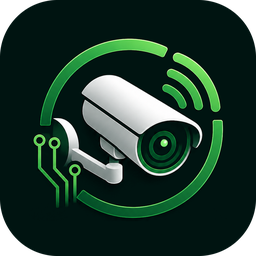

<div align="center">
  

  # G2W Monitor

  **Cliente de monitoramento de câmeras para desktop e celular.**

  [Site](https://monitor.g2wseguranca.com.br) • [Suporte](mailto:contato@g2wseguranca.com.br) • [WhatsApp](https://wa.me/5567996086281)
</div>

---

## O que é

G2W Monitor é o cliente de vídeo da **G2W Tecnologia** para acompanhar câmeras de segurança ao vivo e rever gravações, em computador ou celular.

É uma **versão modificada do [Bluecherry Client](https://github.com/bluecherrydvr/unity)** — um excelente projeto livre, que serve de base para este trabalho. A G2W mantém aqui um conjunto de ajustes voltados ao cenário em que atendemos: servidores com autenticação obrigatória, estações sem GPU dedicada e gravações em H.265.

## Ajustes em relação ao Bluecherry Client

| Ajuste | O que muda na prática |
|---|---|
| Motor de vídeo **media_kit (libmpv)** no desktop | Reprodução de gravações com autenticação por credencial |
| Bibliotecas nativas do media_kit habilitadas no Linux | Permite usar o motor acima em Linux |
| Decodificação por software (`hwdec=no`) | Imagem estável em estações sem GPU dedicada ou sem suporte a decodificação HEVC por hardware |
| Cache do mpv configurado | Permite avançar e retroceder dentro da gravação |
| Busca (*seek*) serializada na linha do tempo | Evita concorrência entre eventos sobrepostos ao mudar a posição do vídeo |

## Versão 1.1.0 (novembro de 2026)

Versão de estabilidade para quem deixa o aplicativo aberto o dia inteiro.

| Mudança | O que muda na prática |
|---|---|
| Registro (*log*) por câmera reescrito | O aplicativo abria o arquivo de registro uma vez por linha, tudo ao mesmo tempo. Numa rajada de mensagens do player faltavam descritores de arquivo (`Too many open files`) e nada mais abria, nem conexão de rede. Agora há uma única escrita por vez, com limite de linhas e de tamanho (2 MB por câmera, uma geração anterior). |
| Registro sem credenciais | Senha na URL, cabeçalho `Authorization`, cookie de sessão e `authtoken` são mascarados antes de ir para arquivo ou para o terminal. Os registros antigos, que guardavam esses dados, são apagados na primeira abertura. |
| Player em nível `warn` | O mpv deixava de gravar milhares de linhas por minuto. Para diagnóstico: `G2W_MONITOR_PLAYER_LOG=v g2w-monitor`. |
| Reconexão automática da câmera parada | O vigia de imagem parada comparava as horas ao contrário e nunca pedia a reconexão; e, quando pedia, o pedido era ignorado se o endereço fosse o mesmo (RTSP). Agora, sem imagem por 42 s, o stream é reaberto (no HLS, com chave nova) e as tentativas continuam, espaçadas até 5 min, enquanto o servidor estiver fora. |
| Memória do ao vivo | Buffer por câmera reduzido de até 96 MiB para 17 MiB, sem cache em disco; a pasta temporária de cada player passa a ser removida. |
| Sem `yt-dlp` | O mpv chamava o `yt-dlp` a cada falha de abertura de um endereço `https`, entregando a ele a URL do servidor. Desligado. |
| Atualização dentro do app | Só oferece versão **mais nova** que a instalada, e baixa o instalador deste repositório (antes apontava para o Bluecherry original). |
| Pacote `.deb`/`.rpm` | O comando `g2w-monitor` volta a existir em `/usr/bin`; ícones de 16 a 512 px. |
| Ícone novo | "Câmera + anel", o mesmo do aplicativo de celular. |
| Outros | Arrastar câmera para fora da grade não gera mais erro; quadros da grade aparecem conforme os players são criados. |

Cada ajuste está isolado em um commit próprio, com a descrição técnica na mensagem. Sempre que forem úteis ao projeto original, enviamos as correções de volta como *pull request*.

## Recursos

- Vários servidores DVR na mesma interface
- Visualização ao vivo em mosaico, com layouts configuráveis
- Linha do tempo de gravações com busca por data e câmera
- Reprodução de gravações **H.265 e H.264**
- Download e exportação de trechos
- Controle PTZ nas câmeras compatíveis
- Permissões por usuário e por câmera (herdadas do servidor)
- Disponível para **Linux, Windows e Android**

## Instalação

### Linux (Debian/Ubuntu)

```bash
sudo apt install -y libmpv2
sudo apt install -y ./g2w-monitor_amd64.deb
```

> `libmpv2` é a biblioteca de vídeo usada pelo aplicativo. Sem ela a reprodução não funciona.

### Windows

Baixe e execute o instalador `g2w-monitor-setup.exe`.

### Android

Instale o `.apk` correspondente à arquitetura do aparelho (`arm64-v8a` na maioria dos celulares atuais).

Os pacotes de cada versão ficam na aba **[Releases](https://github.com/gabrielpst/unity_g2w/releases)**.

## Primeiro acesso

1. Abra o aplicativo e escolha **adicionar servidor**
2. Informe o endereço do servidor, a porta (padrão `7001`), o usuário e a senha
3. As câmeras aparecem automaticamente após a conexão

Precisa de ajuda para configurar? Fale com a gente pelos canais no topo.

## Compilando do código-fonte

Requer [Flutter](https://docs.flutter.dev/get-started/install) **3.44.8** — a mesma versão fixada na integração contínua (`FLUTTER_VERSION` em `.github/workflows/build.yml`).

```bash
git clone https://github.com/gabrielpst/unity_g2w.git
cd unity_g2w
flutter pub get
```

**Linux** — instale as dependências e compile:

```bash
sudo apt install -y clang cmake ninja-build pkg-config libgtk-3-dev liblzma-dev libmpv-dev libsecret-1-dev libjsoncpp-dev
flutter build linux --release
```

Antes de enviar mudanças: `dart format .`, `flutter analyze --no-fatal-infos` e `flutter test`.

**Windows** (precisa ser executado no Windows, com Visual Studio Build Tools):

```bash
flutter build windows --release
```

**Android:**

```bash
flutter build apk --release --split-per-abi
```

## Suporte

**G2W Tecnologia**
📧 contato@g2wseguranca.com.br
📱 (67) 99608-6281
🌐 [monitor.g2wseguranca.com.br](https://monitor.g2wseguranca.com.br)

Problemas técnicos e sugestões também podem ser registrados em [Issues](https://github.com/gabrielpst/unity_g2w/issues).

## Licença e créditos

Este programa é software livre, distribuído sob a **[GNU General Public License v3](LICENSE)**.

G2W Monitor é uma **versão modificada** do Bluecherry Client:

- Bluecherry Client — © 2022 Bluecherry LLC — https://github.com/bluecherrydvr/unity
- Modificações — © 2026 G2W Tecnologia

Você pode usar, estudar, modificar e redistribuir este programa nos termos da GPL v3. O código-fonte completo, incluindo as modificações da G2W, está neste repositório.

*"Bluecherry" é marca da Bluecherry LLC. Este projeto não é afiliado à Bluecherry LLC nem endossado por ela.*
